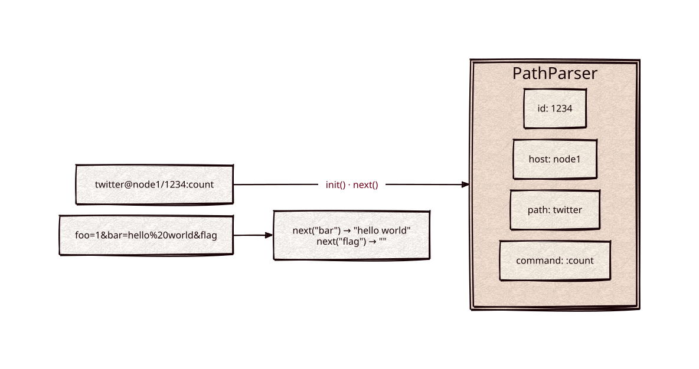

# url-parser

[](https://github.com/Kronuz/url-parser/actions/workflows/ci.yml)
[](LICENSE)


URL path and query parsing for C++20: percent-decode a buffer, read query
parameters by name, and split a request path into its path, host, id, field
selector, and `:command`. For HTTP servers that route on structured paths.



## ✨ Highlights

- **`urldecode`**: `%NN` escapes and `+` decoded, with remappable separators.
- **`QueryParser`**: seek a key with `next("name")`, read its decoded value with
  `get()`; bare flags have an empty value.
- **`PathParser`**: the last segment is the id; `:command`, `{field,selector}`,
  and `path@host` are split off for you.
- **Normalized first.** `//` collapses and `..` segments are dropped, so a path
  cannot climb above its root.

## 📦 Installation

Requires a C++20 compiler and CMake 3.14 or newer; it fetches
[char-classify](https://github.com/Kronuz/char-classify) and compiles one source
file. CI builds it on Linux (x86_64, arm64), macOS (arm64, x86_64), and FreeBSD,
plus ASan, UBSan, and TSan builds.

```cmake
include(FetchContent)
FetchContent_Declare(url_parser
  GIT_REPOSITORY https://github.com/Kronuz/url-parser.git
  GIT_TAG        main)
FetchContent_MakeAvailable(url_parser)

target_link_libraries(my_app PRIVATE url_parser::url_parser)
```

## 🚀 Quick start

```cpp
#include "url_parser.h"

#include <cstring>

int main() {
	urldecode(std::string_view("a%20b+c"));        // "a b c"

	QueryParser qp;
	qp.init("foo=1&bar=hello%20world");
	if (qp.next("bar", std::strlen("bar")) == 0) {
		qp.get();                                  // "hello world"
	}

	PathParser pp;
	pp.init("type/id:count");
	pp.get_id();                                   // "id"
	pp.get_cmd();                                  // ":count"
	pp.next();                                     // State::PTH
	pp.get_pth();                                  // "type"
}
```

[`examples/demo.cc`](examples/demo.cc) decodes, reads query keys, and splits a set
of representative paths.

## 🎯 When to use it

- ✅ Routing HTTP requests on paths of the form `index/id:command`.
- ❌ General URL parsing (schemes, authorities, ports, fragments) or RFC 3986
  path resolution: `..` is dropped, not resolved.

## 📚 Documentation

- [docs/API.md](docs/API.md): `urldecode`, `QueryParser`, `PathParser`, and
  caveats.
- [ARCHITECTURE.md](ARCHITECTURE.md): the decoder and the two-pass path parser.
- [AGENTS.md](AGENTS.md): repository map, invariants, and traps.

## 🛠️ Building and testing

```sh
cmake -B build && cmake --build build && ctest --test-dir build
./build/url_parser_demo
```

## 🤝 Contributing

Issues and pull requests are welcome. Read [AGENTS.md](AGENTS.md) first. CI must
pass on every platform.

## 📄 License

MIT, Copyright (c) 2015-2019 Dubalu LLC. See [LICENSE](LICENSE). Extracted from
[Xapiand](https://github.com/Kronuz/Xapiand), where it routes HTTP requests.
